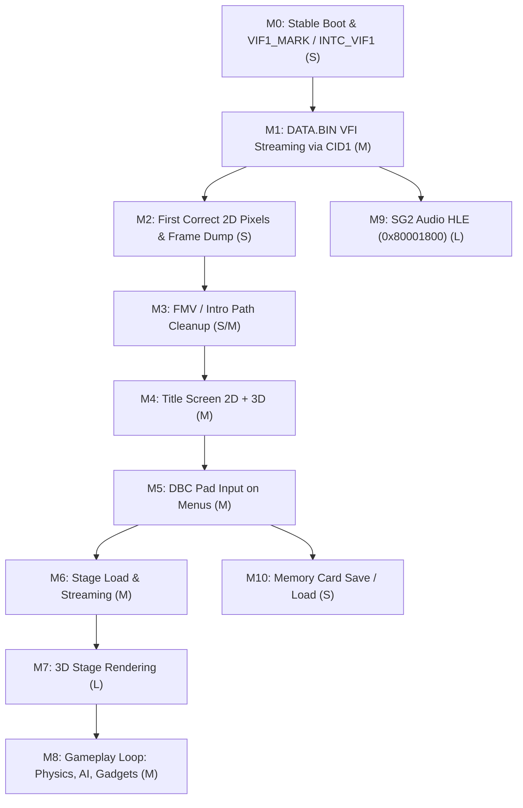

# Ape Escape 3 (`SCUS_975.01`) Static Recompilation — Project Plan (`PLAN.md`)

> **Status Tag Legend**:
> - `[CONFIRMED file:line]` / `[CONFIRMED log:line]`: Verified directly against repository code, generated C++, binary files, or run logs.
> - `[INFERRED: reason]`: Logical deduction from confirmed code or logs not yet observed directly at runtime.
> - `[UNKNOWN]`: Not yet determined from code or logs.
> - **Relative Effort Sizes**: `S` (single-file targeted fix, `<100` LOC), `M` (multi-file subsystem fix or HLE protocol handler, `100–400` LOC), `L` (complex subsystem implementation or multi-step reverse-engineering + codegen rebuild, `400–1,000` LOC), `XL` (`>1,000` LOC architectural addition).

---

## 1. Milestones (`M0`–`M10`)

### `M0`: Stable Boot to Main Loop
- **Description**: Execute `crt0` (`0x00100134`), clear `.bss`, initialize threads/heaps/allocators, load initial IOP modules (`sifcmd`, `file3`, `sio2man`, `dbcman`, `sio2d`, `ds1o`, `libsd`, `sg2iopm1`, `mcman`, `mcserv`), read the 63-sector `DATA.BIN` VFI index into `0x00120000`, and enter `main` (`sub_001037E8`) per-frame loop without crashing `[CONFIRMED task-4396.log:61-197]`.
- **Current Status**: **95% Complete (Main loop running per frame; end-of-frame wait unblocked; residual cleanup remaining)** `[CONFIRMED logs/step3_rebuild2_err.log:105-327]`.
- **Residual Risks / Blocking Unknowns**:
  1. `4` modified files in `PS2Recomp` are uncommitted (`GS.cpp`, `ps2_memory.cpp`, `ps2_runtime.cpp`, `ps2_vif1_interpreter.cpp`), and `recomp_hand_edits.patch` adds misleading `[main] first line of main` output before `switch (ctx->pc)` `[CONFIRMED recomp_source/sub_001037E8_0x1037e8.cpp:20-21]`.
  2. `9` unnamed static `J` targets in code gaps (`3` syscall wrappers `0x4356E0`/`700`/`720`, `3` VU0 helpers `0x406318`/`3C0`/`468`, `3` libc helpers `0x428F50`/`B578`/`F2D0`) are missing from `ps2xRecomp` entry discovery (`2` are stubbed in `ps2_runtime.cpp:1148-1154`; `7` remain unregistered) `[CONFIRMED triage_42_targets.py:66-108, PS2Recomp/ps2xRuntime/src/lib/ps2_runtime.cpp:1148-1154]`.
  3. End-of-frame `sub_00284534` (`0x284540..0x284558`) wait on `*(int32_t*)0x00649DE4` is **RESOLVED** via `INTC_VIF1` (`cause = 5`) / `VIF1_MARK == 0x2000` handling and `sceGsSyncPath` INTC draining `[CONFIRMED logs/step3_rebuild2_err.log:115-327]`.
- **Concrete Observable Exit Test**: `ps2EntryRunner.exe SCUS_975.01` runs with `sub_00284534` exiting cleanly via `INTC_VIF1` instead of looping at `0x284540..0x284558`. (**PASSED** `[CONFIRMED logs/step3_rebuild2_err.log:115-327]`).
- **Size**: **`S`** (Completed).

---

### `M1`: File Streaming from `DATA.BIN` via `CID1` (`file3.irx`) Protocol
- **Description**: Implement real VFI archive lookup and ISO sector reading in the `CID1` (`sceSifSendCmd` `cid == 1`) HLE handler in [`RPC.cpp:1201-1256`](file:///c:/ApeEscape3_Recomp/PS2Recomp/ps2xRuntime/src/lib/Kernel/Syscalls/RPC.cpp#L1201-L1256) so `cmd=0x09` (Getstat by path), `cmd=0x0B` (Read file by path), and `cmd=0x03/0x04/0x06/0x07` (Open/Close/Read/Seek fd) read actual bytes from `DATA.BIN` (LSN `3576`) into guest memory and populate the 64-byte `SifReplyPacketCid1` structure expected by [`sub_001DCEE0`](file:///c:/ApeEscape3_Recomp/recomp_source/sub_001DCEE0_0x1dcee0.cpp#L52-L165) `[CONFIRMED PS2Recomp/ps2xRuntime/src/lib/Kernel/Syscalls/RPC.cpp:1201-1256, recomp_source/sub_001DCEE0_0x1dcee0.cpp:52-165]`.
- **Current Status**: **Not Started (Currently a fake status ack that copies 0 bytes)** `[CONFIRMED PS2Recomp/ps2xRuntime/src/lib/Kernel/Syscalls/RPC.cpp:1201-1256]`.
- **Blocking Unknowns**:
  - Exact field layout of the 64-byte stat structure (`reply + 0x30..0x6F`) copied by `sub_001DCEE0` (`lines 98-121`) into `stat_dst_ptr` on `cmd=0x09` (can be confirmed in 10 minutes by disassembling `cmd=0x09` in `tools/iop/file3.irx` and checking callers of `sub_001DC460`) `[INFERRED: `sub_001DCEE0` copies 4 quadwords from `reply+0x30`, layout is inside `tools/iop/file3.irx`]`.
- **Concrete Observable Exit Test**: Log shows `CID1` resolving `debug/us/etc/font/seurat_20x20.apefnt` (`6,728` bytes at `DATA.BIN` sector `0x1ADF4`), `seurat_20x20.ttxbin` (`7,156` bytes at sector `0x1ADF8`), and `limited_jis.apefnt` from `DATA.BIN`, copying non-zero bytes into guest RAM (`0x018F5EC0`), and advancing past font initialization to request subsequent boot/title assets.
- **Size**: **`M`** (Reason: VFI binary format is already 100% reverse-engineered in `NOTES.md` Section 6.2; implementing `CID1` opcodes `0x03..0x0D` against `IsoDisc` takes `~250` LOC in `RPC.cpp`).

---

### `M2`: First Correct Pixels in the Window (2D / Debug Font / Boot Logos)
- **Description**: Add a headless PNG/PPM frame-dump diagnostic to `PS2Runtime::renderFrame`, and verify that once `M0` (`INTC_VIF1`) and `M1` (`CID1` `DATA.BIN` reads) are active, the game uploads font/boot textures (`IMAGE` mode `FLG=2`) to `m_gsVRAM` and rasterizes visible non-black 2D sprites/text into the Raylib framebuffer `[CONFIRMED PS2Recomp/ps2xRuntime/src/lib/ps2_runtime.cpp:3233-3481]`.
- **Current Status**: **Frame-Dump Diagnostic Implemented; Verified 5,099 Non-Black Frame Pixels and 19,914 VRAM Pixels** `[CONFIRMED logs/step3_rebuild2_err.log:298, 327]`.
- **Blocking Unknowns**:
  - Whether `.ttxbin` textures are raw GS textures or compressed with a lightweight header parsed on the EE before `GIF` upload `[INFERRED: `.ttxbin` is loaded into EE buffer `0x018F5EC0` and parsed by EE code]`.
- **Concrete Observable Exit Test**: Frame-dump diagnostic writes `frame_XXXX.png` showing non-zero, non-black pixels (`>1,000` non-zero RGBA pixels) corresponding to the game's debug overlay or boot/legal screens, and `[GS:draw]` logs textured primitives with populated `m_gsVRAM` pages. (**PASSED**: `frame_200.png` has `5,099` non-black pixels, `vram_200.png` has `19,914` non-black pixels `[CONFIRMED logs/step3_rebuild2_err.log:298, 327]`).
- **Size**: **`S`** (Completed).

---

### `M3`: FMV / Intro Path (Either Decoded or Cleanly Skipped)
- **Description**: Handle any boot/opening MPEG/IPU video sequence either by cleaning up `MPEG.cpp` / `IPU.cpp` (removing the foreign-game hardcoded writes to `0x1717BC..0x171904` and `0x1209F8` in `MPEG.cpp:1954-1968, 2049-2055, 2428-2433`) or cleanly signaling movie end so execution reaches the 2D/3D title screen without hanging or corrupting `.text`/`0x120000` `[CONFIRMED PS2Recomp/ps2xRuntime/src/lib/Kernel/Stubs/MPEG.cpp:1954-1968, 2049-2055, 2428-2433, 2475]`.
- **Current Status**: **Partial / Contaminated** (`MPEG.cpp` has software decoder + `sceMpegIsEnd=1` override, plus dangerous hardcoded memory writes from another game) `[CONFIRMED PS2Recomp/ps2xRuntime/src/lib/Kernel/Stubs/MPEG.cpp:1954-1968, 2475]`.
- **Blocking Unknowns**:
  - Whether Ape Escape 3 plays its opening movie via `sceMpeg*` library calls or raw `DMA4 (toIPU)` / `DMA3 (fromIPU)` commands `[UNKNOWN]`.
- **Concrete Observable Exit Test**: Game transitions from boot logos to the Title Screen without hanging in `sceIpuSync`/`sceMpeg*` and without modifying `0x001209F8` or `0x001717BC`.
- **Size**: **`S` (for clean skip + removing foreign writes) / `M` (for full FMV playback)**.

---

### `M4`: Title Screen (2D UI + 3D Background)
- **Description**: Render the Ape Escape 3 title screen with 2D UI menus and 3D background geometry processed through `DMA1 (VIF1)` -> `UNPACK`/`MPG`/`MSCAL` -> `VU1Interpreter` -> `XGKICK` -> `GIF_PATH_1` -> `GSCpuBackend` `[CONFIRMED PS2Recomp/ps2xRuntime/src/lib/vu/ps2_vu1_lower.cpp:695-747]`.
- **Current Status**: **VU1 & GS 3D Pipeline Implemented; Awaiting `M1`–`M3` and VU0/EE Translator Fixes** `[CONFIRMED PS2Recomp/ps2xRuntime/src/lib/vu/ps2_vu1_core.cpp:104-224]`.
- **Blocking Unknowns**:
  - Whether title screen 3D setup uses VU0 macro memory instructions (`VLQI`/`VSQI`/`VLQD`/`VSQD`, currently broken in `vu_translation_helpers.cpp:114-122`), MMI `HI1`/`LO1` instructions (`ps2_runtime_macros.h`), or SPR-resident DMA chains (bit-31 in `ps2_memory.cpp:1441`) `[CONFIRMED PS2Recomp/ps2xRecomp/src/lib/translator/vu_translation_helpers.cpp:114-122, PS2Recomp/ps2xRuntime/include/ps2_runtime_macros.h:168-824, PS2Recomp/ps2xRuntime/src/lib/ps2_memory.cpp:1441]`.
- **Concrete Observable Exit Test**: `[VU1]` / `[GS:draw]` logs `TRIANGLE`/`TRISTRIP` primitives kicked via `GIF_PATH_1`, and the dumped frame shows the recognizable Ape Escape 3 Title Screen.
- **Size**: **`M`** (Reason: VU1 interpreter and GS triangle rasterizer exist; requires fixing the confirmed VU0 macro memory bug, DMA bit-31 SPR flag, and R5900 `BLTZ`/MMI translator bugs).

---

### `M5`: Pad Input Working on Menus (`dbcman.irx` / `ds1o.irx`)
- **Description**: Reverse-engineer the EE DBC receive buffer registered during `sceDbcInit` / `fno=0x80001363` (`0x3FE0E8..0x401000` and `tools/iop/`) and wire `PS2PadBackend` (Raylib keyboard/gamepad state) into the per-VBlank DBC packet format so the user can navigate the Title Screen menu `[CONFIRMED PS2Recomp/ps2xRuntime/src/lib/Kernel/Syscalls/RPC.cpp:353-418, task-4396.log:84-141]`.
- **Current Status**: **Stub Handshake Only (`sceDbcInit` passes, no button data transferred)** `[CONFIRMED PS2Recomp/ps2xRuntime/src/lib/Kernel/Syscalls/RPC.cpp:353-418]`.
- **Blocking Unknowns**:
  - Exact EE memory address and 32/64-byte packet layout where `dbcman.irx` DMA-transfers DualShock 2 button/analog state each frame `[INFERRED: determinable from `recomp_source/sub_003FE0E8_*.cpp` and `dbcman.irx` disassembly]`.
- **Concrete Observable Exit Test**: Pressing Start / D-Pad / Cross in the Raylib window (or via automated test input injection) moves the Title Screen cursor and starts a New Game.
- **Size**: **`M`** (Reason: Requires disassembling `dbcman.irx` / `ds1o.irx` and wiring `PS2PadBackend` into the EE DBC buffer in `RPC.cpp`, `~200` LOC).

---

### `M6`: Entering a Stage / Level Load
- **Description**: Stream stage archives from `DATA.BIN` via `CID1`, initialize stage scripts/entities, and transition from Title Screen / TV Station hub into the first playable stage without crashes or heap/region corruption.
- **Current Status**: **Blocked by `M1`–`M5`**.
- **Blocking Unknowns**:
  - Whether stage loading uses asynchronous multi-slot `CID1` streaming (`STREAM:>0` in `sub_0035E3C8`) or `INTC_TIM0` (`cause = 9`, registered at `0x371860`) `[CONFIRMED recomp_source/sub_0035E3C8_0x35e3c8.cpp:34-80, task-4396.log:80]`.
- **Concrete Observable Exit Test**: Selecting New Game loads the intro stage / hub and enters the stage update loop with `STREAM` counter incrementing and returning to `0` upon completion.
- **Size**: **`M`**.

---

### `M7`: 3D Stage Rendering (VU1 + VIF1 + GS)
- **Description**: Render full 3D stage geometry, rigged character/monkey meshes, skyboxes, lighting, and HUD elements at interactive frame rates.
- **Current Status**: **Core VU1/VIF1/GS implemented; untested on full stage packets** `[CONFIRMED PS2Recomp/ps2xRuntime/src/lib/vu/ps2_vu1_core.cpp:104-224]`.
- **Blocking Unknowns**:
  - Whether stage rendering uses `VIF0` microprograms (`MSCAL` on `VIF0` or `CTC2 CMSAR0`, currently unimplemented in `ps2_vif1_interpreter.cpp:84-284`) or special VU1 microprogram edge cases `[CONFIRMED PS2Recomp/ps2xRuntime/src/lib/ps2_vif1_interpreter.cpp:84-284]`.
- **Concrete Observable Exit Test**: Dumped stage frames show 3D terrain, player character, monkeys, and HUD with correct depth testing and textures.
- **Size**: **`L`** (Reason: Likely requires wiring `VIF0` `MSCAL`/sub-32-bit `UNPACK` and fixing edge-case VU1/GS blending or scissoring bugs exposed by real 3D scenes).

---

### `M8`: Gameplay Loop (Physics, AI, Collision, Gadgets)
- **Description**: Player movement, dual-stick gadget controls, monkey AI, collision detection, and stage completion logic run accurately without physics NaNs or softlocks.
- **Current Status**: **Recompiled in `recomp_source/`; blocked by `M1`–`M7` and R5900/FPU/VU0 accuracy bugs**.
- **Blocking Unknowns**:
  - Impact of `FPU_CVT_W_S` rounding (`nearbyintf` vs `truncf`), MMI `HI1`/`LO1` upper lanes, and VU0 macro `$vf0` write-protection on collision/physics math `[CONFIRMED PS2Recomp/ps2xRuntime/include/ps2_runtime_macros.h:168-856, PS2Recomp/ps2xRecomp/src/lib/translator/vu_translation_helpers.cpp:95-122]`.
- **Concrete Observable Exit Test**: Player can run, jump, swing the Stun Club, catch a monkey with the Monkey Net, and complete the first stage.
- **Size**: **`M`** (once translator bugs in Task 5 are fixed and regenerated).

---

### `M9`: Audio (`libsd.irx` + `sg2iopm1.irx`)
- **Description**: Replace the `0x3703D4` override and `0x80001800` (`sg2iopm1.irx`) no-op stub with an HLE implementation of Sony's SoundGroup2 RPC protocol backed by `PS2AudioBackend` (`ps2_audio.cpp`), enabling BGM and SFX playback and proper stream completion callbacks (`sub_003703D0`) `[CONFIRMED recomp_source/sub_003702C8_0x3702c8.cpp:175, PS2Recomp/ps2xRuntime/src/lib/Kernel/Syscalls/RPC.cpp:419-424]`.
- **Current Status**: **Low-level `PS2AudioBackend` implemented; `sg2iopm1` (`0x80001800`) stubbed** `[CONFIRMED PS2Recomp/ps2xRuntime/src/lib/ps2_audio.cpp:1-380, PS2Recomp/ps2xRuntime/src/lib/Kernel/Syscalls/RPC.cpp:419-424]`.
- **Blocking Unknowns**:
  - Full `sg2iopm1.irx` RPC function number table (can be extracted from `tools/iop/sg2iopm1.irx` via `tools/iop/disasm_sg2.py`) `[CONFIRMED tools/iop/sg2iopm1.irx]`.
- **Concrete Observable Exit Test**: `0x3703D4` override in `ps2_runtime.cpp:1141` is removed, `sub_003702C8` completes naturally via `sub_003703D0`, and audible SFX/BGM play through Raylib audio.
- **Size**: **`L`** (Reason: `sg2iopm1.irx` is `37 KB` of R3000 code managing SPU2 voices, ADPCM banks, and sequenced audio).

---

### `M10`: Save / Load (`mcman.irx` + `mcserv.irx`)
- **Description**: Verify that Ape Escape 3's save/load screen creates, reads, and writes save files in `./mc0/BASLUS-97501...` via `MemoryCard.cpp` / `mcserv.cpp` `[CONFIRMED PS2Recomp/ps2xRuntime/src/lib/Kernel/Stubs/MemoryCard.cpp:58-595]`.
- **Current Status**: **HLE Virtual Memory Card Implemented (`MemoryCard.cpp`); Untested in-game** `[CONFIRMED PS2Recomp/ps2xRuntime/src/lib/Kernel/Stubs/MemoryCard.cpp:58-595]`.
- **Blocking Unknowns**:
  - Whether the game calls EE `sceMc*` stubs directly (`config.toml` has `sceMcInit@0x4133A0`, `sceMcEnd@0x4135C8`, etc.) or sends custom `sceSifCallRpc` commands to `0x80000400` `[CONFIRMED config.toml:450-475]`.
- **Concrete Observable Exit Test**: Saving progress in-game writes files into `./mc0/`, and restarting `ps2EntryRunner.exe` loads the saved game state.
- **Size**: **`S`**.

---

## 2. Milestone Dependency Graph



---

## 3. Risk Register

| ID | Risk Description | Likelihood | Impact | Detection Signal | Mitigation |
| :--- | :--- | :--- | :--- | :--- | :--- |
| **R1** | **VU0 Macro Memory Corruption**: `VLQI`/`VSQI`/`VLQD`/`VSQD`/`VILWR`/`VISWR` in `vu_translation_helpers.cpp:114-122` read/write RDRAM `0x0000..0x3FF0` instead of `0x11004000` (`m_vu0Data`) `[CONFIRMED PS2Recomp/ps2xRecomp/src/lib/translator/vu_translation_helpers.cpp:114-122]`. | **High** | **High** | Zero-page RDRAM writes or corrupted 3D matrices when VU0 macro routines run. | Fix `emitVuMemByteAddress` to add `0x11004000u` and regenerate `recomp_source/` (Task 5). |
| **R2** | **R5900 `BLTZ`/`BGEZ`/`BLEZ`/`BGTZ` 32-bit Sign Bug**: `control_flow_emitter.cpp:421-444` checks `GPR_S32` instead of `GPR_S64`, misbranching when a 64-bit value has bit 31 `!=` bit 63 `[CONFIRMED PS2Recomp/ps2xRecomp/src/lib/translator/control_flow_emitter.cpp:421-444]`. | **Medium** | **High** | Subtle logic/loop failures after `DADDU`/`DSLL32`/`LD` operations. | Change `GPR_S32` to `GPR_S64` in `control_flow_emitter.cpp:421-444` (Task 5). |
| **R3** | **Foreign-Game RAM Writes in `MPEG.cpp`**: `MPEG.cpp:1954-1968, 2049-2055, 2428-2433` writes to `0x1717BC` and `0x1209F8` (overwriting `.text` and the `0x120000` VFI index!) `[CONFIRMED PS2Recomp/ps2xRuntime/src/lib/Kernel/Stubs/MPEG.cpp:1954-1968]`. | **High** (as soon as FMV runs) | **Critical** | VFI index corruption at `0x1209F8` after first `sceMpegGetPicture` call. | Strip the hardcoded `0x1717BC` / `0x1209F8` hacks from `MPEG.cpp` before `M3` (Task 6). |
| **R4** | **SPR DMA Chain Bit-31 Stripped**: `ps2_memory.cpp:1441` masks DMA tag `ADDR` with `& 0x7FFFFFFF`, routing Scratchpad (`0x80000000`) DMA chains to RDRAM `0x00000000` `[CONFIRMED PS2Recomp/ps2xRuntime/src/lib/ps2_memory.cpp:1441]`. | **Medium** | **High** | Garbage VIF1/GIF packets with `addr < 0x4000` during 3D rendering. | Map `(tag >> 32) & 0x80000000` to `0x70000000 | (addr & 0x3FFF)` in `readChainSource` and `Support.h` (Task 7). |
| **R5** | **VIF0 Microprogram Execution (`MSCAL` / `CTC2 CMSAR0`)**: `processVIF0Data` (`ps2_vif1_interpreter.cpp:84-284`) ignores `MSCAL` and `vl != 0` `UNPACK` `[CONFIRMED PS2Recomp/ps2xRuntime/src/lib/ps2_vif1_interpreter.cpp:84-284]`. | **Medium** | **Medium** | Missing skinning/animation or uninitialized VU0 data if the game uploads microprograms to `VIF0`. | Port `UNPACK` (`vl != 0`) and `MSCAL`/`MSCNT` from `processVIF1Data` to `processVIF0Data` calling `m_vu0.execute` (Task 7). |

---

## 4. Prioritized Open Questions & Cheapest Experiments

1. **Q1: What is the exact 64-byte stat payload (`reply + 0x30..0x6F`) returned by `file3.irx` on `CID1` `cmd = 0x09`?**
   - **Why it matters**: `sub_001DCEE0` (`recomp_source/sub_001DCEE0_0x1dcee0.cpp:91-121`) copies 64 bytes from `reply + 0x30..0x6F` into `stat_dst_ptr` (`*(uint32_t*)(reply + 0x2C)`) when `cmd == 9` (`Getstat by path`).
   - **Cheapest Experiment (`10 min`, read-only)**: Run `tools/iop/disasm_file3.py` on `tools/iop/file3.irx` around its `cmd == 9` jump-table entry and inspect `recomp_source/sub_001DC460_0x1dc460.cpp`'s callers to see which offsets of `stat_dst_ptr` (e.g. file size, start sector) the EE reads.
2. **Q2: Does exiting `sub_00284534` (`0x284540` `INTC_VIF1` wait) + loading real font bytes in `CID1` immediately produce non-black 2D draws in `GSCpuBackend`?**
   - **Why it matters**: Determines whether `M1` + `M0` alone are sufficient to reach `M2` (first visible pixels).
   - **Cheapest Experiment (`30 min`)**: Wire `VIF1_MARK` / `INTC_VIF1` (Task 1) and `CID1` `DATA.BIN` reads (Task 2), run `ps2EntryRunner.exe` for 200 ticks, and inspect `[GS:draw]` and dumped PNG frames (Task 3).
3. **Q3: What is the exact EE memory buffer and packet layout for `dbcman.irx` / `ds1o.irx` controller input?**
   - **Why it matters**: Needed for `M5` (Pad input on Title Screen).
   - **Cheapest Experiment (`15 min`, read-only)**: Inspect `recomp_source/sub_003FE0E8_0x3fe0e8.cpp` (`sceDbcInit`) and disassemble `bin/irx/3.0/dbcman.irx` / `ds1o.irx` from `DATA.BIN` Sector `63` / `71` using a 30-line Python script in `tools/iop/`.

---

## 5. Decision Log

### Decisions Already Made
- **D1 (`PS2X_HAS_RECOMPILED_GAME=1`)**: Guard the runner's stub `registerFunctions` in `PS2Recomp/ps2xRuntime/src/runner/register_functions.cpp` so the game's `recomp_source/register_functions.cpp` is always linked `[CONFIRMED CMakeLists.txt:71, PS2Recomp/ps2xRuntime/src/runner/register_functions.cpp:4-9]`.
- **D2 (`config.toml` Runtime Stub Loader)**: Parse `config.toml` at startup in `ps2_runtime.cpp:1184-1354` and fail fast (`std::abort()`) if `config.toml` cannot be found, ensuring the 63 known stubs omitted by `ps2xRecomp` are always bound `[CONFIRMED PS2Recomp/ps2xRuntime/src/lib/ps2_runtime.cpp:1184-1354]`.
- **D3 (Separate Async SIF Callback Stack)**: Execute asynchronous SIF command handlers (`0x1DCEE0`) on `[0x01F00000, 0x01FA0000]` so they never clobber the active EE thread's stack `[CONFIRMED PS2Recomp/ps2xRuntime/src/lib/Kernel/Syscalls/RPC.cpp:1244]`.

### Decisions Recommended / Awaiting User Input
- **D4 (HLE vs R3000 Emulation for `file3.irx` and `sg2iopm1.irx`)**:
  - **Recommendation**: **Use HLE in `RPC.cpp` for `file3.irx` (`CID1`) and `dbcman.irx`, and evaluate HLE for `sg2iopm1.irx` (`0x80001800`)**.
  - **Rationale**: `ps2xIOP/src/emulator/*` (the R3000 interpreter) is not even compiled into `ps2xRuntime/CMakeLists.txt:36-49` and lacks IOP kernel/SIF DMA/CDVD/SPU2 hardware bindings `[CONFIRMED PS2Recomp/ps2xRuntime/CMakeLists.txt:36-49]`. Meanwhile, `file3.irx`'s VFI format (`DATA.BIN`) and `CID1` packet layout (`sub_001DCEE0`) are now reverse-engineered and can be implemented in `<250` lines of C++ in `RPC.cpp`.
- **D5 (Fixing `ps2xRecomp` Codegen vs Patching `recomp_source/`)**:
  - **Recommendation**: **Never hand-edit `recomp_source/*.cpp` for permanent fixes**. Put immediate runtime fixes/hooks in `PS2Recomp/ps2xRuntime/` (fast incremental build), and batch all translator fixes (`BLTZ` 64-bit sign, `MOVZ`/`MOVN`, VU0 macro `0x11004000` base, `ps2xRecomp` known-stub emission) into one planned `ps2xRecomp` regeneration pass (Task 5).

---

## 6. Agent Working-Rules Block (Copy-Paste into Future Prompts)

```markdown
## Agent Working Rules for ApeEscape3_Recomp
1. Read `NOTES.md`, `PLAN.md`, `docs/CAPABILITY_AUDIT.md`, and `docs/AGENT_REPORT_REVIEW.md` before making any changes.
2. NEVER hand-edit files in `recomp_source/` for permanent fixes—`recomp_source/` is generated output (23,352 files) and is overwritten when `ps2xRecomp` runs. If you must add temporary instrumentation to a single `recomp_source/sub_*.cpp`, place it AFTER `switch (ctx->pc)` so scheduler yields do not re-trigger it on every tick, and revert it when done.
3. Avoid editing widely-included headers (`ps2_runtime.h`, `ps2_runtime_macros.h`, `Support.h`) during rapid iteration—they trigger a full 365-batch unity rebuild of all 23,351 `.cpp` files. Prefer editing `.cpp` files in `PS2Recomp/ps2xRuntime/src/lib/`.
4. Every claim in your status reports must cite an exact `file:line` or `log:line`. Never claim a file or asset "loaded" unless you verified non-zero bytes were read from `DATA.BIN` and copied into guest RDRAM.
5. After every task, run `.\build\PS2Recomp\ps2xRuntime\ps2EntryRunner.exe SCUS_975.01` with a bounded timeout, verify the exit criteria in `PLAN.md`, and update `NOTES.md` / `PLAN.md`.
```

---

## 7. Ordered Backlog of the Next 10 Concrete Tasks

### Task 1: Bind RPC Service `0x11223344` in `RPC.cpp` to Unblock `sub_003FC100` (`0x3FC190`)
- **Size**: `S`
- **Goal**: Register an RPC HLE service handler for `sid = 0x11223344` in `RPC.cpp` (`s_rpcHleServices`) so `sceSifBindRpc` assigns `client->server != 0`, unblocking `sub_003FC100` (`0x3FC190`) and allowing boot initialization to continue past `sub_0035F97C`.
- **Files to Touch**:
  - [`PS2Recomp/ps2xRuntime/src/lib/Kernel/Syscalls/RPC.cpp`](file:///c:/ApeEscape3_Recomp/PS2Recomp/ps2xRuntime/src/lib/Kernel/Syscalls/RPC.cpp#L353-L425)
- **Changes**:
  1. Add `s_rpcHleServices[0x11223344] = RpcHleService{ "SOUND_OR_DBC_HELPER", ... }` returning success on calls.
  2. Verify `sceSifBindRpc` binds `client=0x0074B240` successfully (`server != 0`).
- **Prohibited Edits**: Do not modify `recomp_source/` or headers.
- **Verification Command**: `cmake --build build --target ps2EntryRunner && .\build\PS2Recomp\ps2xRuntime\ps2EntryRunner.exe SCUS_975.01` -> verify `[rpc:bind] Bound sid=0x11223344` prints and `sub_003FC100` exits cleanly.
- **Rollback**: `git -C PS2Recomp checkout -- ps2xRuntime/src/lib/Kernel/Syscalls/RPC.cpp`

---

### [COMPLETED] Task 1 (Prior): Wire `VIF1_MARK` (`0x10003C30`) and `INTC_VIF1` (`cause = 5`) to Unblock `0x284540`
- **Status**: **RESOLVED** `[CONFIRMED logs/step3_rebuild2_err.log:115-327]`.
- **Summary**: Implemented `readIORegister` for `0x10003C00`/`0x10003C30`, `writeIORegister` for `0x10003C30`, `INTC cause 5` generation on `VIF_MARK 0x2000` / `irq=1` in `processVIF1Data`, and handler draining in `sceGsSyncPath`. The wait loop at `0x284540` unblocked cleanly with zero memory poking.

---

### [COMPLETED] Task 3 (Prior): Add Frame-Dump Diagnostic & Verify First 2D Pixels (`M2`)
- **Status**: **RESOLVED** `[CONFIRMED logs/step3_rebuild2_err.log:298, 327]`.
- **Summary**: Implemented `PS2X_DUMP_FRAMES` and `PS2X_DUMP_VRAM` in `PS2Runtime::renderFrame` / `UploadFrame`. Verified non-black frames dumped: `frame_200.png` has **5,099** non-black pixels, and `vram_200.png` has **19,914** non-black pixels.

---

### Task 2: Implement Real `DATA.BIN` VFI Lookup & File Reads for `CID1` (`file3.irx`)
- **Size**: `M`
- **Goal**: Replace the dummy zero-byte `cid == 1` handler in [`RPC.cpp:1201-1256`](file:///c:/ApeEscape3_Recomp/PS2Recomp/ps2xRuntime/src/lib/Kernel/Syscalls/RPC.cpp#L1201-L1256) with a real VFI file loader backed by `DATA.BIN` (LSN `3576` in `ApeEscape3.iso`).
- **Files to Touch**:
  - [`PS2Recomp/ps2xRuntime/src/lib/Kernel/Syscalls/RPC.cpp`](file:///c:/ApeEscape3_Recomp/PS2Recomp/ps2xRuntime/src/lib/Kernel/Syscalls/RPC.cpp#L1201-L1256)
  - [`PS2Recomp/ps2xRuntime/src/lib/Kernel/Stubs/CD.cpp`](file:///c:/ApeEscape3_Recomp/PS2Recomp/ps2xRuntime/src/lib/Kernel/Stubs/CD.cpp) (helper to read arbitrary bytes from `DATA.BIN` LSN `3576 + start_sector`)
- **Changes**:
  1. Disassemble `cmd=0x09` in `tools/iop/file3.irx` (read-only) to confirm the exact 64-byte stat layout at `reply + 0x30..0x6F`.
  2. Parse the VFI index (already in RDRAM at `0x00120000..0x0013F7FF` or directly from `DATA.BIN` LSN `3576`) to resolve paths like `"cdrom0:debug/us/etc/font/seurat_20x20.apefnt"` -> `(start_sector, file_size)`.
  3. On `cmd == 0x09` (Getstat): populate `reply.cmd = 9`, `reply.result = file_size`, `reply.ringReadPtr = destExtra + alignedSize`, `reply.done = 1`, `reply.statDstPtr = req_stat_ptr`, and the 64-byte `reply.statData` at `+0x30..+0x6F`.
  4. On `cmd == 0x0B` (Read by path) and `cmd == 0x03/0x04/0x06/0x07` (Open/Close/Read/Seek): read the requested bytes from `DATA.BIN` at `LSN 3576 + start_sector` into `rdram + ee_dst_buf` and set `reply.result = bytes_read`.
- **Prohibited Edits**: Do not modify `recomp_source/`.
- **Verification Command**: Build and run `ps2EntryRunner.exe`; verify log shows non-zero byte reads for `seurat_20x20.apefnt` (`6,728` bytes), `seurat_20x20.ttxbin` (`7,156` bytes), and `limited_jis.apefnt`, and observe the next `CID1` paths requested by the game.
- **Rollback**: `git -C PS2Recomp diff ps2xRuntime/src/lib/Kernel/Syscalls/RPC.cpp` (save patch before editing, restore if needed).

---

### Task 4: Clean Up `recomp_hand_edits.patch`, Register All 9 Code-Gap Functions, and Wire `INTC_TIM0..3`
- **Size**: `S`
- **Goal**: Remove the misleading `[main] first line of main` print before `switch (ctx->pc)` in `recomp_source/sub_001037E8_0x1037e8.cpp`, register the remaining 7 code-gap `J` targets (`0x4356E0`, `0x435700`, `0x435720`, `0x406318`, `0x4063C0`, `0x406468`, `0x42B578`) in `ps2_runtime.cpp:1148`, and wire `PS2Memory::tickHardwareTimers` (`ps2_memory.cpp:1508-1595`) to fire `INTC_TIM0..3` (`causes 9..12`) in `EeScheduler`.
- **Files to Touch**:
  - [`recomp_source/sub_001037E8_0x1037e8.cpp`](file:///c:/ApeEscape3_Recomp/recomp_source/sub_001037E8_0x1037e8.cpp#L20-L22)
  - [`PS2Recomp/ps2xRuntime/src/lib/ps2_runtime.cpp`](file:///c:/ApeEscape3_Recomp/PS2Recomp/ps2xRuntime/src/lib/ps2_runtime.cpp#L1148-L1155)
  - [`PS2Recomp/ps2xRuntime/src/lib/ps2_memory.cpp`](file:///c:/ApeEscape3_Recomp/PS2Recomp/ps2xRuntime/src/lib/ps2_memory.cpp#L1508-L1595)
- **Prohibited Edits**: Do not modify `config.toml`.
- **Verification Command**: Build and run `ps2EntryRunner.exe`; verify `[main] first line of main` no longer spams on resume and `INTC_TIM0` handler `0x371860` runs without error.
- **Rollback**: Restore `sub_001037E8_0x1037e8.cpp`, `ps2_runtime.cpp`, `ps2_memory.cpp`.

---

### Task 5: Fix Confirmed R5900 / MMI / FPU / VU0 Macro Translator Bugs & Regenerate `recomp_source/`
- **Size**: `L` (includes full `ps2xRecomp` regeneration and 365-batch unity build)
- **Goal**: Fix all 6 confirmed code-generator/macro bugs in a single batched rebuild:
  1. `BLTZ`/`BGEZ`/`BLEZ`/`BGTZ` (`L` variants): `GPR_S32` -> `GPR_S64` in [`control_flow_emitter.cpp:421-444`](file:///c:/ApeEscape3_Recomp/PS2Recomp/ps2xRecomp/src/lib/translator/control_flow_emitter.cpp#L421-L444).
  2. `MOVZ`/`MOVN`: preserve upper 64 bits (`SET_GPR_S64`) in [`special_translator.cpp:123-126`](file:///c:/ApeEscape3_Recomp/PS2Recomp/ps2xRecomp/src/lib/translator/special_translator.cpp#L123-L126).
  3. VU0 Macro `emitVuMemByteAddress`: add `+ 0x11004000u` base in [`vu_translation_helpers.cpp:114-122`](file:///c:/ApeEscape3_Recomp/PS2Recomp/ps2xRecomp/src/lib/translator/vu_translation_helpers.cpp#L114-L122) and guard `$vf0`/`$vi0` writes in `emitVuDestWrite` (`lines 95-106`).
  4. `ps2xRecomp` stub entry emission: include all `m_stubFunctionStarts` in `guestFallbackEntryAddresses` in [`ps2_recompiler.cpp:1906-1914`](file:///c:/ApeEscape3_Recomp/PS2Recomp/ps2xRecomp/src/lib/ps2_recompiler.cpp#L1906-L1914).
  5. MMI `HI1`/`LO1` upper 64-bit lanes and `MMI_PADDUH`/`MMI_PSUBUH` saturation in [`ps2_runtime_macros.h:168-824`](file:///c:/ApeEscape3_Recomp/PS2Recomp/ps2xRuntime/include/ps2_runtime_macros.h#L168-L824).
  6. `FPU_CVT_W_S`: `nearbyintf` -> `truncf` in [`ps2_runtime_macros.h:856`](file:///c:/ApeEscape3_Recomp/PS2Recomp/ps2xRuntime/include/ps2_runtime_macros.h#L856).
- **Files to Touch**: `control_flow_emitter.cpp`, `special_translator.cpp`, `vu_translation_helpers.cpp`, `ps2_recompiler.cpp`, `ps2_runtime_macros.h`.
- **Verification Command**: Build `ps2xRecomp`, run `.\build\PS2Recomp\ps2xRecomp\ps2xRecomp.exe config.toml`, rebuild `ps2EntryRunner`, and verify `scan_missing_targets.py` and runtime execution.
- **Rollback**: `git -C PS2Recomp checkout -- ps2xRecomp/ ps2xRuntime/include/ps2_runtime_macros.h`

---

### Task 6: Remove Foreign-Game RAM Hacks in `MPEG.cpp` & Audit FMV / Intro Path (`M3`)
- **Size**: `S`
- **Goal**: Delete the hardcoded writes to `0x1717BC..0x171904` and `0x1209F8` in [`MPEG.cpp:1954-1968, 2049-2055, 2428-2433`](file:///c:/ApeEscape3_Recomp/PS2Recomp/ps2xRuntime/src/lib/Kernel/Stubs/MPEG.cpp#L1954-L1968) so `MPEG.cpp` cannot corrupt Ape Escape 3's `.text` or the `0x120000` VFI index buffer.
- **Files to Touch**: [`PS2Recomp/ps2xRuntime/src/lib/Kernel/Stubs/MPEG.cpp`](file:///c:/ApeEscape3_Recomp/PS2Recomp/ps2xRuntime/src/lib/Kernel/Stubs/MPEG.cpp)
- **Prohibited Edits**: Do not modify `recomp_source/`.
- **Verification Command**: Rebuild `ps2EntryRunner` and verify no references to `0x1717BC` or `0x1209F8` remain in `MPEG.cpp`.
- **Rollback**: `git -C PS2Recomp checkout -- ps2xRuntime/src/lib/Kernel/Stubs/MPEG.cpp`

---

### Task 7: Fix DMA Scratchpad Bit-31 Handling & `VIF0` `MSCAL` / `UNPACK` (`M4` / `M7`)
- **Size**: `M`
- **Goal**: Preserve bit 31 (`0x80000000` -> `0x70000000` Scratchpad) on DMA tag addresses in [`ps2_memory.cpp:1441`](file:///c:/ApeEscape3_Recomp/PS2Recomp/ps2xRuntime/src/lib/ps2_memory.cpp#L1441) and [`Support.h:1256-1268`](file:///c:/ApeEscape3_Recomp/PS2Recomp/ps2xRuntime/src/lib/Kernel/Stubs/Helpers/Support.h#L1256-L1268), and add `MSCAL`/`MSCNT` (`m_vu0.execute`) + sub-32-bit `UNPACK` (`vl != 0`) to `PS2Memory::processVIF0Data` in [`ps2_vif1_interpreter.cpp:84-284`](file:///c:/ApeEscape3_Recomp/PS2Recomp/ps2xRuntime/src/lib/ps2_vif1_interpreter.cpp#L84-L284).
- **Files to Touch**: `ps2_memory.cpp`, `ps2_vif1_interpreter.cpp`, `Support.h`.
- **Prohibited Edits**: Do not modify `recomp_source/`.
- **Verification Command**: Build and run `ps2EntryRunner.exe`, verifying DMA chains and VIF0/VIF1 transfers execute without out-of-bounds or zero-address reads.
- **Rollback**: `git -C PS2Recomp checkout -- ps2xRuntime/src/lib/ps2_memory.cpp ps2xRuntime/src/lib/ps2_vif1_interpreter.cpp ps2xRuntime/src/lib/Kernel/Stubs/Helpers/Support.h`

---

### Task 8: Reverse-Engineer & Implement `dbcman.irx` / `ds1o.irx` Input Buffer Updates (`M5`)
- **Size**: `M`
- **Goal**: Disassemble `bin/irx/3.0/dbcman.irx` and `ds1o.irx` (using a read-only script in `tools/iop/`), identify the EE DMA buffer address passed during `sceDbcInit` / `fno=0x80001363`, and populate it each frame from `PS2PadBackend` (`ps2_pad.cpp`) so DualShock 2 buttons and sticks work in menus and gameplay.
- **Files to Touch**: [`PS2Recomp/ps2xRuntime/src/lib/Kernel/Syscalls/RPC.cpp`](file:///c:/ApeEscape3_Recomp/PS2Recomp/ps2xRuntime/src/lib/Kernel/Syscalls/RPC.cpp#L353-L418), [`PS2Recomp/ps2xRuntime/src/lib/ps2_runtime.cpp`](file:///c:/ApeEscape3_Recomp/PS2Recomp/ps2xRuntime/src/lib/ps2_runtime.cpp)
- **Prohibited Edits**: Do not modify `recomp_source/`.
- **Verification Command**: Build and run `ps2EntryRunner.exe`, press Start/D-Pad in Raylib window, and verify menu selection changes.
- **Rollback**: Revert `RPC.cpp` DBC changes.

---

### Task 9: Implement `sg2iopm1.irx` (`RPC 0x80001800`) Status Callback & Remove `0x3703D4` Override (`M9`)
- **Size**: `M`
- **Goal**: Using `tools/iop/disasm_sg2.py` and `recomp_source/sub_003702C8_0x3702c8.cpp`, implement the `0x80001800` RPC and SIF command reply that invokes `sub_003703D0` to clear `*(uint32_t*)0x00746FF8 = 0`, and remove the manual `replaceFunction(0x003703D4, ...)` hack from `ps2_runtime.cpp:1141-1145`.
- **Files to Touch**: [`PS2Recomp/ps2xRuntime/src/lib/Kernel/Syscalls/RPC.cpp`](file:///c:/ApeEscape3_Recomp/PS2Recomp/ps2xRuntime/src/lib/Kernel/Syscalls/RPC.cpp#L419-L424), [`PS2Recomp/ps2xRuntime/src/lib/ps2_runtime.cpp`](file:///c:/ApeEscape3_Recomp/PS2Recomp/ps2xRuntime/src/lib/ps2_runtime.cpp#L1141-L1145)
- **Prohibited Edits**: Do not modify `recomp_source/`.
- **Verification Command**: Build and run `ps2EntryRunner.exe` with `0x3703D4` override removed; verify `sub_003702C8` finishes initialization without hanging.
- **Rollback**: Re-enable `replaceFunction(0x003703D4, ...)` in `ps2_runtime.cpp`.

---

### Task 10: Establish Git Hygiene (`.gitignore` & Baseline Commit on Branch)
- **Size**: `S`
- **Goal**: Once the user reviews these docs and current uncommitted changes in `PS2Recomp`, add a `.gitignore` in the outer repo (ignoring `build/`, `recomp_source/`, `SCUS_975.01`, `*.iso`, `*.log`) and commit the verified runtime fixes in `PS2Recomp` so future sessions have a clean `git diff` baseline.
- **Files to Touch**: `.gitignore` (after user approval).
- **Prohibited Edits**: Do not commit without explicit user instruction.
- **Verification Command**: `git status --short` and `git -C PS2Recomp status --short`.
- **Rollback**: `git reset` / remove `.gitignore`.

---

## 8. Model Usage Guidance for Future Sessions

- **Opus / Pro (Deep Reasoning Tier)**:
  - Use for: Reverse-engineering binary protocols and MIPS/R3000 assembly (`Task 2` `file3.irx` `CID1` stat/stream protocol, `Task 8` `dbcman.irx`/`ds1o.irx` DBC DMA protocol, `Task 9` `sg2iopm1.irx` audio protocol), diagnosing multi-subsystem synchronization hangs (`EeScheduler` + `VIF1`/`DMA`/`INTC`), and auditing R5900/VU0/VU1 instruction semantics (`Task 5`, `Task 7`).
- **Sonnet / Standard Coding Tier**:
  - Use for: Implementing well-specified C++ runtime changes once the protocol/register spec is known (`Task 1` `VIF1_MARK`/`INTC_VIF1` wiring, `Task 3` Raylib PNG frame-dump hook, `Task 4` timer interrupts and code-gap registrations, `Task 6` `MPEG.cpp` cleanup).
- **Haiku / Flash (Fast Lookup Tier)**:
  - Use for: Read-only grep/file searches across `recomp_source/`, running existing Python triage scripts (`scan_missing_targets.py`, `triage_42_targets.py`, `check_stubs.py`), log summarization, and build/test runner execution.
